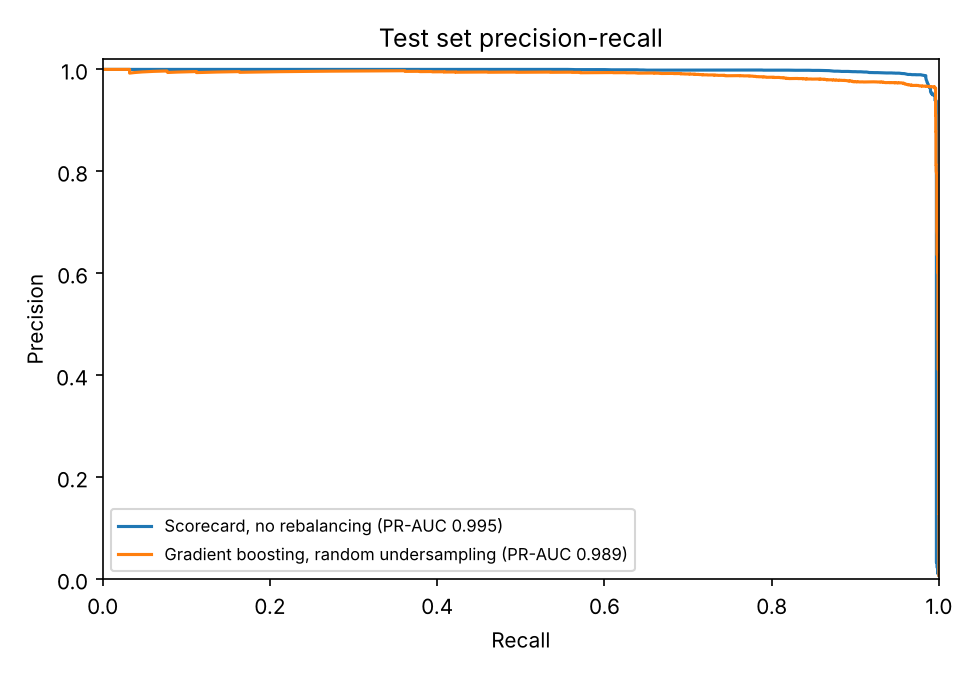
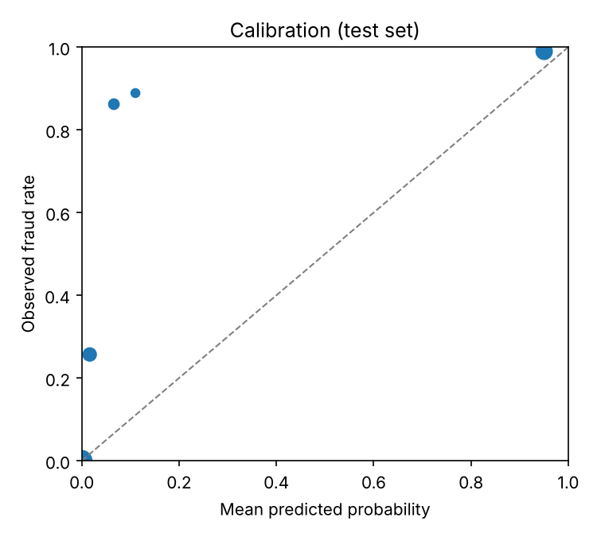

# Model card: FinGuard fraud scorecard

*Version 1.0.0, trained 2026-10-27. Generated by `ml/train_fraud_model.py`; do not edit by hand.*

## What it does
Scores each payment for fraud risk at the moment it is made, using only what FinGuard knows then: the amount, the sender's balance before the payment, the share of that balance being moved, the hour of day and the transaction type. Scores at or above the High threshold open a fraud alert; Medium scores are logged for monitoring.

**Algorithm:** Logistic regression on binned features (additive scorecard), L2 regularisation C=3.0, trained on the data as it is (no rebalancing scored best on validation).

Because the model is additive in log-odds, every score splits exactly into one contribution per feature (exact SHAP values for this model class). The API returns these contributions with each score.

## Data
PaySim is a simulated mobile-money transaction log (Lopez-Rojas, Elmir and Axelsson, 2016) built from one month of real transactions of an African mobile-money service. Source: PaySim, Kaggle ealaxi/paysim1 (licence CC BY-SA 4.0). Rows used: 2,770,409 TRANSFER and CASH_OUT transactions, of which 8,213 are fraud (0.30%).

| Split (by time) | Steps | Rows | Frauds | Fraud rate |
| --- | --- | --- | --- | --- |
| train | 1-281 | 1,672,907 | 3,193 | 0.19% |
| validation | 282-354 | 544,998 | 762 | 0.14% |
| test | 355-743 | 552,504 | 4,258 | 0.77% |

## Model selection
Two model families, four ways of handling the class imbalance (about 1 fraud in 337 payments). Settings were chosen on the validation split only; the test split was used once, for the final numbers.

| Model | Imbalance handling | Validation PR-AUC | Test PR-AUC | Test ROC-AUC |
| --- | --- | --- | --- | --- |
| Scorecard (binned logistic regression) (deployed) | no rebalancing | 0.994 | 0.995 | 0.998 |
| Gradient boosting (HistGradientBoosting) | no rebalancing | 0.935 | 0.979 | 1.000 |
| Scorecard (binned logistic regression) | class weights | 0.990 | 0.994 | 0.999 |
| Gradient boosting (HistGradientBoosting) | class weights | 0.900 | 0.968 | 1.000 |
| Scorecard (binned logistic regression) | random undersampling | 0.993 | 0.995 | 0.999 |
| Gradient boosting (HistGradientBoosting) | random undersampling | 0.954 | 0.989 | 1.000 |
| Scorecard (binned logistic regression) | SMOTE | 0.993 | 0.995 | 0.999 |
| Gradient boosting (HistGradientBoosting) | SMOTE | 0.935 | 0.980 | 1.000 |

The deployed model is the scorecard with the best validation PR-AUC (no rebalancing). The best gradient-boosting variant (chosen on validation, random undersampling) scores 0.006 lower test PR-AUC, so here the simpler, fully explainable model is also the more accurate one. Class-imbalance handling made little difference to the scorecard.

## Test results (deployed model)
PR-AUC 0.995 · ROC-AUC 0.998 · Brier score 0.0003

| Level | Probability threshold | Precision | Recall | Alerts per 10,000 payments |
| --- | --- | --- | --- | --- |
| High (opens an alert) | 0.665 | 99.0% | 97.2% | 75.7 |
| Medium or above | 0.066 | 99.0% | 97.7% | 76.1 |

Rule baselines on the same test set:

| Rule | Precision | Recall | Same alerts as the model's High level |
| --- | --- | --- | --- |
| Moves the entire balance (99.9% to 100%) | 99.0% | 97.2% | 100.0% |
| Moves the entire balance and is a TRANSFER | 99.8% | 47.5% | 48.5% |
| Amount above 10,000 (from the old rules) | 0.8% | 96.7% | 0.8% |

## What these numbers mean
On PaySim, the model's High alerts are 100.0% the same payments as the one-line rule "Moves the entire balance (99.9% to 100%)". The simulated fraud has one dominant pattern, so a single rule already captures it and the near-perfect scores say more about the simulator than about the model.

What the model adds here: graded scores rather than a yes/no rule (the Medium band catches 18 more test frauds), an exact explanation of every score, and a training and evaluation pipeline that can be re-run on a bank's own labelled payments, where single rules perform far worse.

## What drives the score

| Feature | Mean absolute contribution (log-odds) |
| --- | --- |
| Sender balance before | 1.27 |
| Share of balance moved | 1.12 |
| Transaction type | 0.50 |
| Amount | 0.31 |
| Hour of day | 0.23 |

 

## Limitations
- The near-perfect test scores reflect how simple PaySim's fraud is: almost every fraud empties an account to the cent, which legitimate PaySim payments rarely do. Real fraud is far harder to separate; expect much lower precision and recall on real data.
- Trained on simulated data. PaySim amounts are in the simulator's currency and FinGuard applies them to euros unchanged; the bins should be re-fitted on a bank's own labelled payments before any real use.
- PaySim's hour of day is simulation time; FinGuard scores with the UTC hour of the payment.
- Fraud in PaySim is dominated by one pattern (an account emptied by a transfer, then cashed out), so the model mostly learns that pattern. It will not recognise fraud that looks different.
- Recipient balances were excluded because PaySim leaves them unchanged for many fraud rows, a simulator artefact that a real ledger does not have.
- The model sees one payment at a time: no customer history, device, location or velocity features.
- Contributions are measured against an average PaySim payment, and almost half of PaySim's senders have a zero balance while many others pay more than their balance. A normal partial payment is therefore unusual in the data, so 'share of balance moved' can raise the score slightly even for a low-risk payment.
- The fraud rate in the test period (later in the simulation) is about four times the training rate, so probabilities in the middle range are underestimated; the ranking (PR-AUC) is what was optimised.
